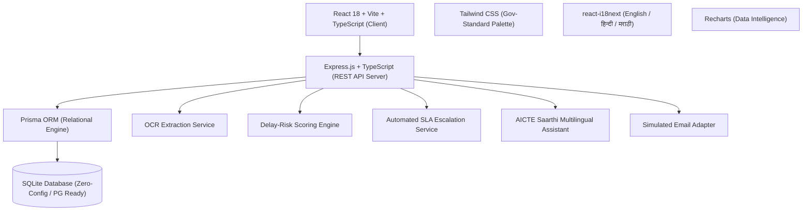
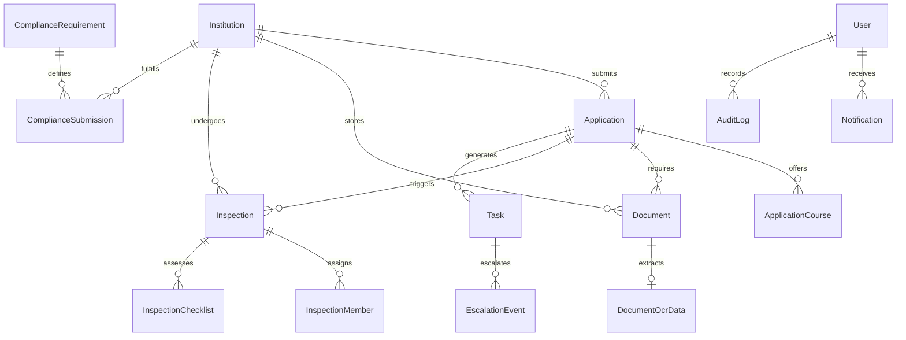

# AnumatiSetu (अनुमतिसेतु / अनुमतिसेतू)
### *National Institutional Permission, Approval & Compliance Management Portal*
**Ministry of Education & All India Council for Technical Education (AICTE)**  
*Statutory digital platform aligned with AICTE Approval Process Handbook (APH 2026–27).*

---

## 🏛️ Executive Summary

**AnumatiSetu** is a production-grade, full-stack digital governance platform engineered to automate institutional approval lifecycles, enforce regulatory compliances under the AICTE Approval Process Handbook (APH 2026-27), extract certificate metadata via OCR, detect conflicts of interest in EVC inspections, and proactively escalate overdue statutory deadlines through multi-tier SLA alerting.

### Core Key Features
- **Official Government-Standard UI**: Classic, restrained visual identity tailored around Indian public-sector digital principles (Deep Navy `#061D45`, Government Blue `#1565C0`, Saffron `#F4A900`, Forest Green `#15803D`, and Amber `#B45309`).
- **Complete Trilingual Localization**: Full, native-quality support for **English (`en`)**, **Hindi (`hi`)**, and **Marathi (`mr`)** across all headings, KPI cards, form controls, canonical status badges, notifications, and AICTE Saarthi assistant responses without page reloads.
- **7-Tier Role-Based Access Control (RBAC)**: Backend-enforced authorization and data isolation across Super Admin, Central Admin, Bureau Officer, Regional Officer, EVC Member, Institution Admin, and Vigilance Auditor.
- **End-to-End Approval Workflow Engine**: Configurable 6-stage lifecycle (`Draft` ➔ `Submitted` ➔ `Initial Validation` ➔ `Under Scrutiny` ➔ `Deficiency Notice Loop` ➔ `EVC Inspection` ➔ `Committee Review` ➔ `Approved / Rejected`).
- **Intelligent OCR Certificate Pre-fill & Review**: Automatic extraction of certificate numbers, validity dates, and issuing authorities from statutory documents (Fire NOC, Land Title Deeds, Building Plans).
- **Automated SLA Breach & Hierarchical Escalation**: Multi-tier escalation engine (Level 1: 3-day breach ➔ Scrutiny Officer; Level 2: 7-day breach ➔ Regional Director; Level 3: 14-day critical breach ➔ Member Secretary HQ).
- **EVC Inspection Conflict-of-Interest Detection**: Automatic algorithmic guard preventing appointment of committee experts affiliated with the applicant institution or parent university (APH §2.4).
- **AICTE Saarthi (एआईसीटीई सारथी)**: Trilingual conversational governance assistant with deterministic APH 2026-27 handbook grounding and official chapter/clause citations.
- **One-Click Demo Role Switcher & Presentation Mode**: Instant role switching from the top header and repeatable database reset for evaluation.

---

## 🏗️ Architecture & Technology Stack



- **Frontend**: React 18, TypeScript, Vite, Tailwind CSS, Lucide React, Recharts, react-i18next, clsx.
- **Backend**: Node.js, Express.js, TypeScript, Prisma ORM, JWT, bcryptjs, Multer, Helmet, Morgan.
- **Database**: SQLite (default zero-config portable database with 20+ models, foreign keys, and indexes) / PostgreSQL compatible.
- **Testing**: Vitest, Supertest.

---

## 👥 Stakeholder Roles & Demo Credentials

All demo user accounts are pre-seeded and accessible with password: **`Password@123`**.  
Evaluators can also use the **"Quick Role Switcher"** button located in the top header to switch roles instantly with a single click.

| Role | Stakeholder Name & Designation | Official Email | Scope of Authority |
|---|---|---|---|
| **Super Administrator** | Shri Rajeshwar Rao (CTO) | `superadmin@aicte.gov.in` | Global system control, user creation, workflow templates, audit logs, demo reset. |
| **Central AICTE Admin** | Prof. T. G. Sitharam (Secretariat) | `centraladmin@aicte.gov.in` | Council oversight, final approval/rejection orders, national pendency reports. |
| **Bureau Officer** | Dr. Amit V. Deshmukh (Engg Bureau) | `bureau.officer@aicte.gov.in` | Scrutiny desk, deficiency notices, OCR verification, advancing stages. |
| **Regional Officer** | Dr. Sunil K. Sonawane (WRO Director) | `regional.wro@aicte.gov.in` | Regional coordination, scheduling EVC inspections, conflict detection. |
| **EVC Expert Member** | Prof. Milind Atrey (IIT Bombay) | `evc.expert@iitb.ac.in` | Committee chairman, physical/virtual checklist scoring, recommendation reports. |
| **Institutional Admin** | Dr. Faruk Kazi (Nodal Officer, GCET) | `principal@gcet.edu.in` | Application creation, course intake, document uploads, compliance evidence. |
| **Vigilance Auditor** | Smt. Kavita Sharma (IRS) | `auditor.vigilance@aicte.gov.in` | Read-only compliance oversight, immutable audit trail, vigilance inspection. |

---

## 🗄️ Relational Database Schema



---

## 🚀 Quickstart & Setup Guide

### Prerequisites
- **Node.js**: v18.0.0 or higher (v24 LTS recommended)
- **npm**: v9.0.0 or higher

### 1. Installation
Clone the repository and install all dependencies for root, server, and client:
```bash
# Clone the repository
git clone https://github.com/your-username/anumatisetu-portal.git
cd anumatisetu-portal

# Install root dependencies
npm install

# Setup backend (install packages, generate Prisma client, push schema, seed demo data)
npm run setup:server

# Setup frontend (install client packages)
npm run setup:client
```

### 2. Run the Application
Run both backend and frontend concurrently with a single command:
```bash
npm run dev
```

- **Frontend Application**: [http://localhost:5173](http://localhost:5173)
- **Backend API Server**: [http://localhost:5000/api/v1](http://localhost:5000/api/v1)
- **Health Check Endpoint**: [http://localhost:5000/api/v1/health](http://localhost:5000/api/v1/health)

### 3. Run Automated Tests
```bash
npm test
```
Executes the comprehensive Vitest integration suite verifying:
- Health and system uptime
- Demo accounts retrieval
- JWT authentication and token verification
- Role-based application scoping
- Real database KPI dashboard calculation
- Automated SLA escalation triggers
- Trilingual AI assistant query responses with APH citations

---

## 🎬 Step-by-Step Demonstration Script (For Evaluators)

Follow this 16-step sequence to review all portal capabilities:

1. **Login & Role Check**:
   - Navigate to [http://localhost:5173](http://localhost:5173).
   - Click the **"One-Click Stakeholder Demo Switcher"** for **`INSTITUTION_ADMIN`** (Dr. Faruk Kazi - GCET Mumbai).
2. **Instant Language Switching (Hindi)**:
   - In the top utility bar, click **"हिन्दी"**.
   - Notice how all navigation links, dashboard KPI cards, status labels, and dates immediately switch to formal Hindi without a page reload.
3. **Application Creation**:
   - Go to **"आवेदन प्रबंधन"** (Applications) and click **"Create New Application"**.
   - Select **Extension of Approval (EoA)** for AY 2026-2027.
   - Enter proposed intake for an AI/ML course, accept the statutory declaration, and submit.
4. **Instant Language Switching (Marathi)**:
   - In the top header, click **"मराठी"**.
   - The entire interface transitions to formal administrative Marathi.
5. **Switch to Bureau Scrutiny Officer**:
   - Use the **"त्वरित भूमिका बदला"** (Role Switcher) in the header to switch to **`BUREAU_OFFICER`** (Dr. Amit V. Deshmukh).
   - Open the newly submitted application dossier.
6. **Intelligent OCR Certificate Verification**:
   - Go to the **"Mandatory Documents & OCR"** tab.
   - Click **"Verify OCR"** on the Municipal Fire NOC.
   - Notice the extracted Certificate Number, Issue Date, Expiry Date, and 96% match confidence score. Click **"Confirm & Save"**.
7. **Issue Deficiency Notice**:
   - In the action bar, click **"त्रुटी नोटीस काढा"** (Raise Deficiency Notice).
   - Enter deficiency text: *"Please provide renewed Fire Safety NOC acknowledgement receipt."*
   - Notice the status immediately changes to **`DOCUMENTS_REQUIRED`** and the AI Delay-Risk score automatically recalculates to HIGH.
8. **Institutional Response**:
   - Switch role back to **`INSTITUTION_ADMIN`**.
   - Open the notification drawer (bell icon) to see the deficiency notification.
   - Click **"View Email Template"** to open the realistic simulated bilingual email preview.
9. **Schedule EVC Inspection with Conflict-of-Interest Guard**:
   - Switch role to **`REGIONAL_OFFICER`** (Dr. Sunil K. Sonawane, Western Region Director).
   - Navigate to **"EVC Inspections"** and click **"Schedule EVC Inspection"**.
   - Select the pending application dossier, set date, and assign committee chair. Notice how the conflict-of-interest check confirms independence.
10. **Record On-Site EVC Observation & Checklist**:
    - Switch role to **`EVC_MEMBER`** (Prof. Milind Atrey, IIT Bombay).
    - Under **"EVC Inspections"**, click **"Submit Inspection Report"**.
    - Mark the statutory checklist items (Infrastructure, Labs, Faculty Biometric Roster, Divyangjan Ramps) as Compliant, select **"RECOMMENDED FOR APPROVAL"**, and submit.
11. **Grant Final Council Approval**:
    - Switch role to **`CENTRAL_ADMIN`** (Prof. T. G. Sitharam, Council Secretariat).
    - Open the application dossier and click **"Record Council Decision"**.
    - Select **`APPROVED`**, record the approval order reference, and submit.
12. **Trigger Automated SLA Breach Escalation**:
    - Navigate to **"Tasks & Escalations"**.
    - Click **"Scan & Trigger Escalations"**.
    - Watch the automated engine scan all active tasks, detect overdue statutory windows, and trigger Level 1 and Level 2 escalations with critical red alerts!
13. **Consult AICTE Saarthi**:
    - Click the **"AICTE Saarthi"** button in the header.
    - Ask in English, Hindi, or Marathi: *"What are the Fire NOC requirements?"* or *"संकाय कैडर अनुपात नियम क्या हैं?"*.
    - Observe the regulatory explanation and citations to APH 2026-27 Chapter II / Appendix 7.
14. **Analytics & Data Export**:
    - Open **"Reports & Analytics"**.
    - Inspect the average processing turnaround duration and compliance fulfillment rate.
    - Click **"Export to CSV"** to download the complete official spreadsheet.
15. **Inspect the Immutable Audit Trail**:
    - Open **"Audit Trail"**.
    - Review the chronological log showing every single stage transition, document review, and decision with exact actor role, timestamp, and IP address.
16. **Reset Demo State**:
    - Go to **"System Administration"**.
    - Click **"Reset Demo State"** to restore pristine baseline records anytime during presentation.

---

## 🔒 Security & Privacy Features

- **Password Encryption**: All passwords securely hashed using `bcryptjs` with salt rounds.
- **JWT Protection**: Session tokens signed with HMAC-SHA256 and configurable expiry.
- **Strict Data Isolation**: Institutional administrators can only access dossiers and documents belonging to their verified institution PID.
- **Zero Real Data**: 100% synthetic demonstration data compliant with Indian privacy directives.
- **Audit Logging**: Every consequential administrative action is permanently recorded in the database.

---

## 📜 Regulatory Reference

*AnumatiSetu is aligned with the Approval Process Handbook (APH 2026-27) published by the All India Council for Technical Education (AICTE), Ministry of Education, Government of India.*
