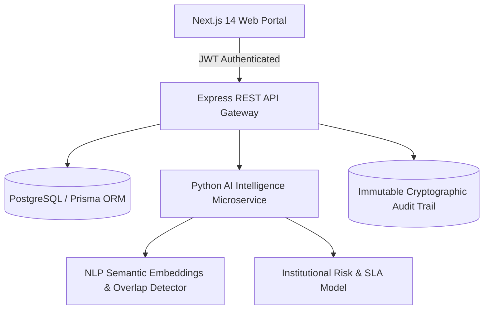

# AICTE Sanyojika (संयोजिका) 🏛️

> **Intelligent Multi-Bureau Institution Complaint Monitoring & Inter-Agency Coordination Platform**  
> *Smart India Hackathon (SIH 2026) — Problem Statement 262 / 264*

[](https://sih-264.vercel.app)
[](https://sih264.onrender.com)
[](docs/SANYOJIKA_ARCHITECTURE.md)
[](client)
[](tests)

---

## 📌 Executive Overview

**Sanyojika** is an enterprise-grade AI governance platform developed for the **All India Council for Technical Education (AICTE)**. It breaks through administrative silos between the **Public Grievance Redressal Cell (PGRC)**, **Regional Bureaus (RB)**, **Approval Bureau**, and **Central Vigilance Cell**.

Using advanced semantic NLP embeddings, real-time overlap collision detection, and topological graph intelligence, Sanyojika prevents contradictory rulings, flags duplicate complaints across independent portals, and orchestrates cross-bureau joint inquiry mandates.

---

## 🚀 Key Functional Modules

| # | Module | Description | Documentation |
| :--- | :--- | :--- | :--- |
| **01** | **Role Authentication & RBAC** | Instant persona switching across HQ, Regional Bureau, PGRC & Scrutiny. | [User Manual](docs/SANYOJIKA_USER_MANUAL.md#1-authentication--role-switching) |
| **02** | **Integrated Dashboard** | Executive telemetry: 220+ complaints, 68 overlap collisions, 4 mandates. | [Dashboard Spec](docs/SANYOJIKA_USER_MANUAL.md#2-integrated-executive-dashboard) |
| **03** | **Grievance Ingestion** | Central registry submission with instant AI collision scoring. | [Intake Flow](docs/SANYOJIKA_USER_MANUAL.md#3-grievance-registration) |
| **04** | **Complaints Repository** | High-performance multi-faceted search, status filters, and CSV exports. | [Repository Guide](docs/SANYOJIKA_USER_MANUAL.md#4-complaints-repository--multi-faceted-filtering) |
| **05** | **Complaint Detail Dossier** | Comprehensive chronological timeline and OCR document inspector. | [Dossier Inspection](docs/SANYOJIKA_USER_MANUAL.md#5-complaint-detail-dossier-inspection) |
| **06** | **Institutions Directory** | Pan-India college directory with 50+ colleges and Permanent PID lookups. | [Institutions Guide](docs/SANYOJIKA_USER_MANUAL.md#6-institutions-directory) |
| **07** | **AI Overlap Detection** | Semantic similarity engine identifying cross-bureau case collisions. | [Overlap Engine](ai_engine/nlp_embeddings.py) |
| **08** | **Side-by-Side Comparison** | Dual-pane case inspector highlighting shared allegations and evidence. | [Compare Spec](docs/SANYOJIKA_USER_MANUAL.md#8-side-by-side-dual-pane-case-comparison) |
| **09** | **Cross-Bureau Coordination** | Formal joint inquiry mandates, consensus voting, and Append Action notes. | [Coordination Protocol](docs/CROSS_BUREAU_COORDINATION_PROTOCOL.md) |
| **10** | **Relationship Graph** | Interactive force-directed topological network of cases and colleges. | [Graph Topology](docs/SANYOJIKA_ARCHITECTURE.md#33-force-directed-relationship-topology-graph) |
| **11** | **Executive Analytics** | Regional heatmaps, SLA compliance curves, and bureau turnaround stats. | [Analytics Spec](docs/SANYOJIKA_USER_MANUAL.md#11-reports--executive-analytics) |
| **12** | **Audit History Ledger** | Append-only immutable transaction log ensuring zero-tamper governance. | [Security & Audit](docs/SECURITY_AND_RBAC_MODEL.md) |

---

## 🛠️ System Architecture



---

## 💻 Tech Stack

- **Frontend:** Next.js 14, React 18, TypeScript, TailwindCSS, Lucide Icons, Canvas Physics
- **Backend Services:** Node.js, Express, Prisma ORM, JWT, SQLite / PostgreSQL
- **AI Microservice:** Python 3.11, FastAPI / Flask, NumPy, Scikit-learn, PyTesseract OCR
- **Hosting & Infrastructure:** Vercel (Edge CDN), Render (Compute & Databases), GitHub Actions (CI/CD)

---

## 🧪 Local Quickstart

### Prerequisites
- Node.js 18+ & npm
- Python 3.10+
- Git

### 1. Clone the Repository
```bash
git clone https://github.com/Virajmahale21/sanyojika-ps262.git
cd sanyojika-ps262
```

### 2. Run the AI Microservice
```bash
python -m unittest discover tests/
python scripts/sanyojika_healthcheck.py
```

### 3. Launch Frontend & Backend
```bash
# Backend
cd server
npm install
npm run dev

# Frontend (in a separate terminal)
cd client
npm install
npm run dev
```
Open [http://localhost:3000](http://localhost:3000) in your browser.

---

## 👥 Smart India Hackathon (SIH 2026) Team
- **Project:** AICTE Sanyojika (Problem Statement 262 / 264)
- **Lead Developer:** Viraj Mahale ([@Virajmahale21](https://github.com/Virajmahale21))
- **Ministry / Department:** All India Council for Technical Education (AICTE), Ministry of Education
