# AICTE Saarthi — Regulatory AI Copilot Specification

## 1. Executive Overview

**AICTE Saarthi** is the integrated AI regulatory assistant in AnumatiSetu, providing real-time compliance guidance, deficiency prevention, and handbook retrieval for both applicant institutions and regulatory scrutiny officers.

---

## 2. Architecture & Knowledge Retrieval Flow

```mermaid
flowchart LR
    UserQuery["User Natural Language Query"] --> Guardrails["Prompt Guardrails & Sanitizer"]
    Guardrails --> VectorSearch["Embeddings Search over APH 2026-27"]
    VectorSearch --> ContextInjection["Context Assembly & Statutory Citations"]
    ContextInjection --> Inference["Domain-Tuned Regulatory Model"]
    Inference --> ResponseFilter["Factuality Verifier & Output Formatting"]
    ResponseFilter --> Output["Actionable Advisory & Clause References"]
```

---

## 3. Core Functional Capabilities

### A. Real-Time Application Deficiency Pre-Check
- Automatically evaluates institution inputs (land area, built-up area, faculty cadre ratio, laboratory floor plans) against Chapter I, II, and Appendix 4 of the Approval Process Handbook.
- Alerts applicants before submission to prevent common scrutiny rejection cycles.

### B. Natural Language Regulatory Consultation
- Answers queries regarding:
  - Extension of Approval (EoA) timelines and fee structures.
  - Eligibility criteria for introduction of Emerging Tech courses (AI, Data Science, Cyber Security, Robotics).
  - Norms for Autonomous Colleges and Deemed-to-be Universities.
  - Multi-disciplinary program conversion rules.

### C. Tri-Lingual Conversational Support
- Native understanding and responses in **English**, **Hindi (हिन्दी)**, and **Marathi (मराठी)**.

---

## 4. Ethical Guardrails & Compliance Safety

To ensure administrative fairness and prevent hallucinations:
1. **Zero Hallucination Tolerance:** The assistant strictly cites exact clause numbers and page references from APH 2026-27.
2. **Advisory Scope Guard:** AI suggestions are explicitly marked as *advisory guidance* and do not supersede statutory decisions of the Executive Committee.
3. **No PII Exposure:** User credentials and confidential institution inspection notes are scrubbed before inference.
