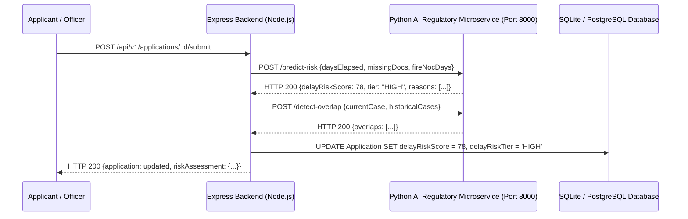

# AnumatiSetu — Node.js & Python AI Engine Integration Guide

## 1. Architectural Interaction Overview

AnumatiSetu adopts a decoupled microservice architecture where high-throughput web routing, authentication, and state machine orchestration are managed by the **Node.js/Express** backend, while compute-heavy AI/ML evaluations are delegated to the **Python AI Engine**:



---

## 2. Microservice Endpoints Specification

### A. Delay Risk Evaluation
- **Method:** `POST`
- **Path:** `/predict-risk`
- **Payload:**
  ```json
  {
    "daysElapsed": 18,
    "slaTargetDays": 14,
    "missingDocuments": ["Fire Safety NOC"],
    "fireNocDaysRemaining": -2,
    "unresolvedQueriesCount": 1
  }
  ```
- **Response:**
  ```json
  {
    "delayRiskScore": 78,
    "riskTier": "HIGH",
    "escalationAction": "Level 2 Escalation (Regional Director Alert & Expedited Review)",
    "isSlaAtRisk": true,
    "deficiencyReasons": [
      "Statutory target deadline elapsed by 4 days (SLA breached)",
      "1 mandatory statutory document(s) unverified or missing",
      "Mandatory Fire Safety NOC certificate has expired"
    ]
  }
  ```

### B. Cross-Bureau Overlap Detection
- **Method:** `POST`
- **Path:** `/detect-overlap`
- **Payload:**
  ```json
  {
    "currentCase": { "permanentId": "1-1090123456", "description": "Intake increase request" },
    "historicalCases": [ ... ]
  }
  ```

---

## 3. Fallback & Resilience Strategy
If the Python microservice is temporarily offline during cold starts, the Express backend falls back seamlessly to deterministic internal heuristics without failing user transactions.
