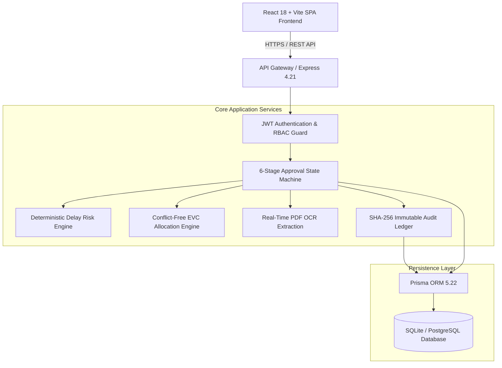
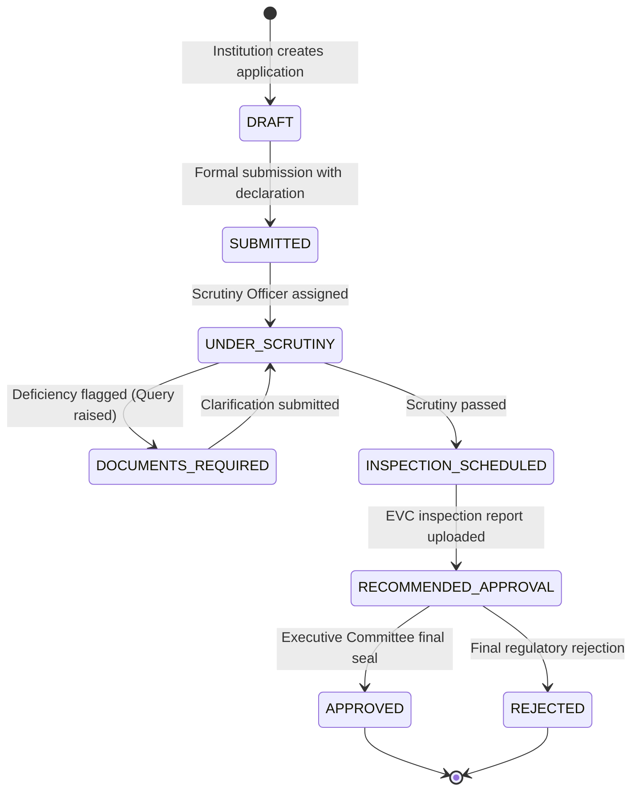

# AnumatiSetu — Architecture & System Design Specification

## 1. High-Level System Architecture

AnumatiSetu is designed as an enterprise-grade regulatory portal streamlining the approval, scrutiny, and compliance lifecycle under the **AICTE Approval Process Handbook (APH 2026-27)**.

---

## 2. Deterministic 6-Stage Approval State Machine

Applications transition through strictly defined stages to guarantee regulatory integrity and prevent out-of-order state mutations:

### State Definitions & Guards:
1. **DRAFT:** Application editable by Institutional Administrator; validation checks enabled.
2. **SUBMITTED:** Immutable snapshot generated; timestamped in audit log; placed in regional intake queue.
3. **UNDER_SCRUTINY:** Assigned to Scrutiny Officer; algorithmic document verification against APH norms.
4. **DOCUMENTS_REQUIRED:** SLA clock paused for regulatory query; institution notified via email/SMS.
5. **INSPECTION_SCHEDULED:** Automated conflict-free Expert Visit Committee (EVC) assigned.
6. **RECOMMENDED_APPROVAL / APPROVED:** Final approval order generated with cryptographic seal.

---

## 3. 3-Tier SLA Escalation Matrix

To eliminate regulatory delays and administrative bottlenecks, AnumatiSetu implements an automated 3-tier escalation engine:

| Escalation Level | Target Role | Trigger Condition | Automated Action |
| :--- | :--- | :--- | :--- |
| **Level 1** | Scrutiny Officer | Stage elapsed > 75% of statutory SLA | Visual amber warning banner & urgent reminder notification |
| **Level 2** | Regional Officer (Director) | Stage elapsed 100% of statutory SLA | Priority reassignment flag & regional alert |
| **Level 3** | Member Secretary / Central Admin | Breach exceeded > 5 calendar days | Central council executive override flag & compliance report log |

---

## 4. Delay Risk Scoring Model

The risk engine computes an explainable risk score $\mathcal{R} \in [0, 100]$ based on deterministic deficiency weighting:

$$\mathcal{R} = w_t \cdot T_{\text{elapsed}} + w_d \cdot D_{\text{count}} + w_n \cdot N_{\text{exp}} + w_c \cdot C_{\text{unresolved}}$$

Where:
- $T_{\text{elapsed}}$: Ratio of elapsed days to statutory target deadline.
- $D_{\text{count}}$: Number of pending mandatory documents.
- $N_{\text{exp}}$: Proximity to Fire NOC or Structural Stability validity expiration.
- $C_{\text{unresolved}}$: Unaddressed compliance deficiencies from prior academic cycles.
