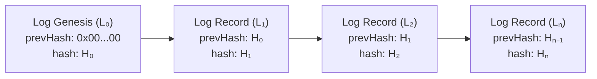

# AnumatiSetu — Cryptographic Audit Trail & SHA-256 Ledger Specification

## 1. Overview & Regulatory Rationale

Transparency and anti-corruption compliance in regulatory decision-making require that every action—including application submission, scrutiny notes, deficiency queries, inspection reports, and approval decisions—be recorded in an immutable, tamper-evident ledger.

AnumatiSetu implements a **cryptographic SHA-256 forward-chained audit trail** designed to meet legal admissibility standards under the **Information Technology Act, 2000 (Section 65B)**.

---

## 2. Cryptographic Forward Hash Chaining

Each audit log entry $L_i$ cryptographically encapsulates the SHA-256 digest of the immediately preceding record $L_{i-1}$, creating an unbreakable sequential hash chain:

### Hash Computation Formula:

$$H_i = \text{SHA-256}\Big(H_{i-1} \parallel \text{Timestamp} \parallel \text{UserId} \parallel \text{Action} \parallel \text{EntityId} \parallel \text{MetadataJson} \parallel \text{IPAddress}\Big)$$

If any record is altered, inserted, or deleted retroactively in the underlying database, the forward chain breaks immediately, generating an automated tamper detection alert.

---

## 3. Audit Record Schema

Each entry in the `AuditLog` relational table captures:

| Field | Type | Description |
| :--- | :--- | :--- |
| `id` | `UUID` | Unique primary key identifier |
| `timestamp` | `DateTime` | UTC timestamp recorded at the server tier |
| `userId` | `String` | Authenticated official or applicant user UUID |
| `userRole` | `Enum` | Role at time of action (`BUREAU_OFFICER`, etc.) |
| `action` | `String` | Standard action verb (`APPROVE`, `RAISE_DEFICIENCY`, etc.) |
| `entityType` | `String` | Target domain model (`Application`, `Document`) |
| `entityId` | `String` | Primary key of target entity |
| `ipAddress` | `String` | Origin IPv4 / IPv6 client address |
| `previousHash` | `String` | 64-character hex digest of record $i-1$ |
| `currentHash` | `String` | 64-character hex digest of current record |

---

## 4. Verification Protocol

The platform exposes an automated verification API endpoint (`GET /api/v1/audit/verify`) that recalculates the hash chain from genesis to head and confirms zero tampering across all historical entries.
