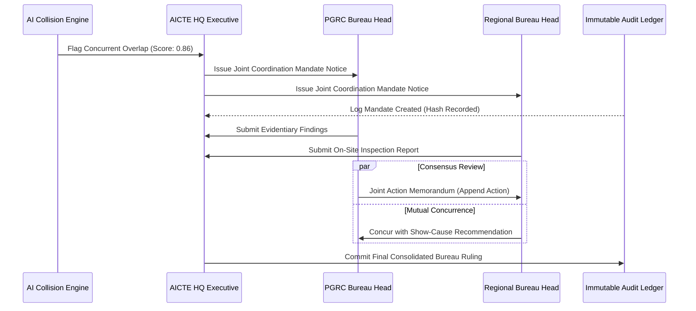

# AICTE Sanyojika - Inter-Bureau Coordination Protocol (IBCP)

**Specification Reference:** AICTE-IBCP-2026-V1  
**Target Entities:** Public Grievance Redressal Cell (PGRC), Regional Bureaus (RB), Approval Bureau (AB), Vigilance Cell (VC)

---

## 1. Overview & Objective

The **Inter-Bureau Coordination Protocol (IBCP)** establishes binding administrative workflows when the Sanyojika AI engine flags a high-confidence overlap between two or more grievances or regulatory inquiries involving the same institution.

---

## 2. Trigger Conditions

An IBCP Mandate is automatically provisioned when:
1. **PID Collision:** $\ge 2$ independent cases filed against the same AICTE Permanent ID (PID) across distinct bureaus within a 90-day window.
2. **Semantic Similarity Threshold:** Narrative cosine embedding similarity $\ge 0.78$ indicating duplicated or related underlying facts (e.g. capitation fee collection masquerading as development fees).
3. **High Institutional Risk Index:** Composite risk score $\ge 75/100$.

---

## 3. Workflow Lifecycle

---

## 4. Append Action Governance
- Any bureau officer assigned to an active mandate may invoke `Append Action`.
- Actions are append-only; historical notes cannot be modified or purged.
- Every entry records:
  - Timestamp (UTC +05:30)
  - Officer Name & Bureau Identifier
  - Official Memorandum Summary
  - Evidentiary Attachment Checksum (SHA-256)
