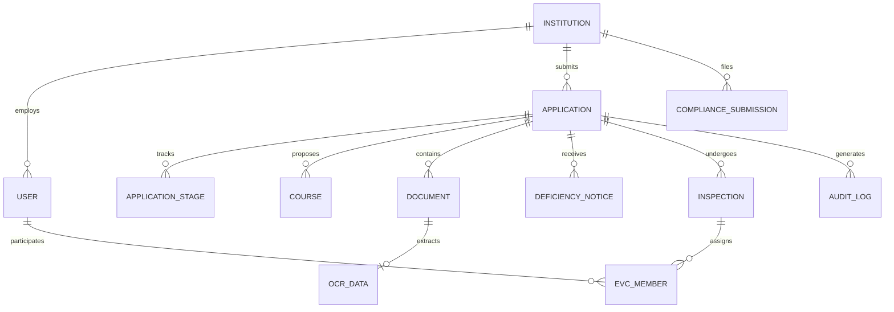

# AnumatiSetu Database Architecture & Schema

AnumatiSetu utilizes **Prisma ORM** with a normalized relational schema designed for high-concurrency statutory governance, audit compliance, and SLA tracking.

---

## 🏛️ Schema Entity Relationship Diagram



---

## 📊 Core Tables & Enums

### 1. `User`
Stores credential records, role-based access attributes, regional bureau allocations, and contact parameters.
- **Enums**: `Role` (`SUPER_ADMIN`, `CENTRAL_ADMIN`, `BUREAU_OFFICER`, `REGIONAL_OFFICER`, `EVC_MEMBER`, `INSTITUTION_ADMIN`, `VIGILANCE_AUDITOR`).

### 2. `Institution`
Stores permanent institution profile, permanent institute ID (PID), institutional category (Engineering, Management, Pharmacy, Architecture), physical address, GIS coordinates, and affiliation details.

### 3. `Application`
Represents the core regulatory filing lifecycle.
- **Enums**:
  - `ApplicationType`: `NEW_INSTITUTE`, `EXTENSION_OF_APPROVAL`, `INCREASE_INTAKE`, `NEW_COURSE`, `CLOSURE`.
  - `ApplicationStatus`: `DRAFT`, `SUBMITTED`, `UNDER_REVIEW`, `DEFICIENCY_ISSUED`, `INSPECTION_SCHEDULED`, `APPROVED`, `REJECTED`.
  - `StageCode`: `STAGE_DRAFT`, `STAGE_SUBMITTED`, `STAGE_VALIDATION`, `STAGE_SCRUTINY`, `STAGE_DEFICIENCY`, `STAGE_EVC`, `STAGE_SAC`, `STAGE_FINAL_DECISION`.

### 4. `Document` & `OcrData`
Stores uploaded compliance documents along with AI OCR extracted metadata (Certificate Number, Extracted Issue Date, Extracted Expiry Date, Authority).

### 5. `Inspection` & `EvcMember`
Manages Expert Visit Committee inspection schedules, committee member rosters, geofenced inspection proof uploads, and conflict-of-interest verifications under APH §2.4.

### 6. `AuditLog`
An append-only, tamper-evident audit ledger capturing actor ID, IP address, timestamp, event action (`CREATE`, `UPDATE`, `STAGE_ADVANCE`, `DECISION`), and before/after JSON diffs.

---

## 🗄️ Database Engines & Migration

- **Development & Single-Node**: SQLite (`file:./dev.db`) for zero-dependency execution.
- **Enterprise & Cloud**: PostgreSQL / MySQL compatible via Prisma datasource configuration:
  ```prisma
  datasource db {
    provider = "postgresql"
    url      = env("DATABASE_URL")
  }
  ```
