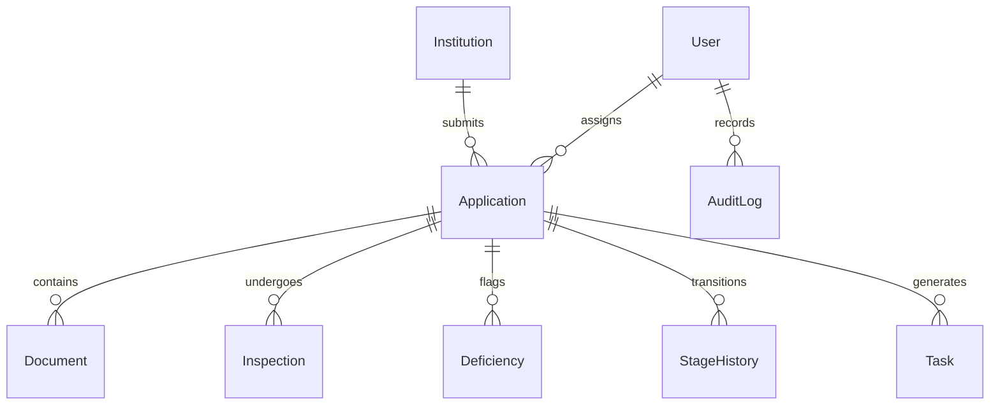

# AnumatiSetu — Data Dictionary & Relational Schema Reference

## 1. Relational Model Overview

AnumatiSetu persistence layer comprises **21 strongly-typed relational entities** modeled via Prisma ORM under AICTE regulatory governance specifications:

---

## 2. Core Entities & Field Specifications

### A. `User` (Authentication & RBAC)
| Column | Type | Constraints | Description |
| :--- | :--- | :--- | :--- |
| `id` | `UUID` | Primary Key | Unique internal user identifier |
| `email` | `String` | Unique, Not Null | Official login email |
| `passwordHash` | `String` | Not Null | Bcrypt hashed password (10 rounds) |
| `fullName` | `String` | Not Null | Full official name |
| `role` | `Enum` | Not Null | `SUPER_ADMIN`, `CENTRAL_ADMIN`, `BUREAU_OFFICER`, etc. |
| `institutionId`| `UUID` | Foreign Key | Attached institution for Institution Admins |

### B. `Institution` (Academic Entity Registry)
| Column | Type | Constraints | Description |
| :--- | :--- | :--- | :--- |
| `id` | `UUID` | Primary Key | Unique institution UUID |
| `permanentId` | `String` | Unique, Not Null | Official AICTE Permanent ID (e.g. `1-1090123456`) |
| `name` | `String` | Not Null | Full approved institutional legal name |
| `category` | `String` | Not Null | `ENGINEERING`, `MANAGEMENT`, `PHARMACY` |
| `state` | `String` | Not Null | Indian state or union territory |
| `regionalOffice` | `String` | Not Null | `WRO`, `NRO`, `SRO`, `ERO`, `CRO`, `NWRO`, `SWRO`, `SCRO` |

### C. `Application` (Regulatory Dossier)
| Column | Type | Constraints | Description |
| :--- | :--- | :--- | :--- |
| `id` | `UUID` | Primary Key | Unique application UUID |
| `applicationNumber`| `String` | Unique, Not Null | Formatted statutory ID (e.g. `AICTE/2026-27/APP-1004`) |
| `status` | `Enum` | Not Null | `DRAFT`, `SUBMITTED`, `UNDER_SCRUTINY`, `APPROVED`, etc. |
| `delayRiskScore` | `Int` | Default 0 | Real-time computed risk score ($0–100$) |
| `delayRiskLevel` | `String` | Default 'LOW' | Categorical tier: `LOW`, `MEDIUM`, `HIGH` |
| `submissionDate` | `DateTime` | Nullable | Exact timestamp of official submission |
| `targetDueDate` | `DateTime` | Not Null | Calculated statutory SLA deadline |

### D. `AuditLog` (Cryptographic Ledger)
| Column | Type | Constraints | Description |
| :--- | :--- | :--- | :--- |
| `id` | `UUID` | Primary Key | Sequential log record UUID |
| `timestamp` | `DateTime` | Default Now | Immutable UTC timestamp recorded at server |
| `userId` | `String` | Not Null | Actor UUID |
| `action` | `String` | Not Null | Action verb (`LOGIN`, `APPROVE`, `RAISE_QUERY`) |
| `previousHash` | `String` | Not Null | 64-character SHA-256 digest of record $i-1$ |
| `currentHash` | `String` | Not Null | 64-character SHA-256 digest of current record |
