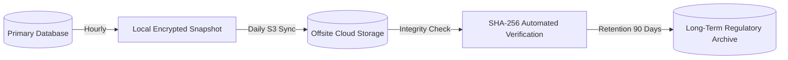

# AnumatiSetu — Disaster Recovery & High Availability (HA) Runbook

## 1. Regulatory Service Level Objectives (SLOs)

Under National Government Data Centre and AICTE mission-critical standards:

| Metric | Target SLA | Strategy |
| :--- | :--- | :--- |
| **Recovery Time Objective (RTO)** | $\le 15\text{ minutes}$ | Automated container failover & multi-zone replication |
| **Recovery Point Objective (RPO)** | $\le 1\text{ hour}$ | Automated hourly differential database snapshots |
| **System Availability** | $99.95\%$ Uptime | Zero-downtime rolling deployments via Vercel Edge CDN |
| **Cryptographic Integrity** | $100\%$ Verifiable | SHA-256 hash chaining verification before traffic restore |

---

## 2. Backup Execution & Retention Schedule



### Automation Scripts:
- **Linux / Bash:** [`scripts/backup-db.sh`](../scripts/backup-db.sh)
- **Windows / PowerShell:** [`scripts/backup-db.ps1`](../scripts/backup-db.ps1)

---

## 3. Disaster Recovery Restoration Procedure

### Phase 1: Assessment & Traffic Drainage
1. Drain ingress traffic from affected zone to secondary standby edge.
2. Freeze active state machine mutations via administrative maintenance mode flag:
   ```bash
   export MAINTENANCE_MODE=true
   ```

### Phase 2: Database Restoration
1. Identify latest verified database snapshot in `./backups/`.
2. Verify cryptographic SHA-256 digest:
   ```bash
   sha256sum -c backups/anumatisetu_sqlite_YYYYMMDD_HHMMSS.db.sha256
   ```
3. Restore database snapshot to primary location:
   ```bash
   cp backups/anumatisetu_sqlite_YYYYMMDD_HHMMSS.db prisma/dev.db
   ```
4. Execute Prisma database validation:
   ```bash
   npx prisma db pull
   ```

### Phase 3: Integrity Validation & Service Resumption
1. Run database health diagnostic:
   ```bash
   npx ts-node scripts/verify-db-health.ts
   ```
2. Verify cryptographic audit chain integrity (`GET /api/v1/audit/verify`).
3. Re-enable public ingress traffic and verify live health endpoint (`GET /api/v1/health`).
