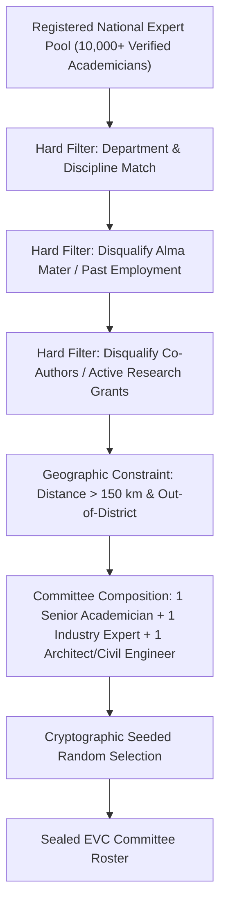

# Expert Visit Committee (EVC) — Conflict-Free Allocation Algorithm

## 1. Regulatory Context

Under AICTE statutory regulations, surprise or scheduled physical/virtual inspections of technical institutions must be conducted by an independent Expert Visit Committee (EVC). To guarantee zero bias and eliminate conflicts of interest, AnumatiSetu implements an automated algorithmic committee selection pipeline.

---

## 2. Selection Criteria & Constraints Matrix

---

## 3. Algorithmic Formulation

For target institution $I$, an expert $E_j$ from pool $\mathcal{E}$ is eligible if and only if all boolean constraint checks satisfy:

$$\text{Eligible}(E_j, I) = \mathcal{C}_{\text{disc}}(E_j, I) \wedge \neg \mathcal{C}_{\text{affil}}(E_j, I) \wedge \neg \mathcal{C}_{\text{geo}}(E_j, I) \wedge \neg \mathcal{C}_{\text{prior}}(E_j, I)$$

Where:
- $\mathcal{C}_{\text{disc}}(E_j, I)$: Discipline match (e.g. Mechanical, Computer Engineering, Management).
- $\mathcal{C}_{\text{affil}}(E_j, I)$: Active or past affiliation (employment within last 7 years, graduation, family relations).
- $\mathcal{C}_{\text{geo}}(E_j, I)$: Geographic proximity within same municipal district or $< 150\text{ km}$.
- $\mathcal{C}_{\text{prior}}(E_j, I)$: Inspected the same institution in the previous 3 academic cycles.

---

## 4. Acceptance Declaration & Integrity Seal

1. **Digital Declaration:** Committee members must sign an automated digital declaration confirming zero conflict of interest before accessing confidential institutional annexures.
2. **Geo-Tagged Inspection:** Inspection reports and geo-tagged photographic evidence are uploaded with live GPS coordinates and timestamping directly to the portal.
3. **Audit Ledger Logging:** The entire allocation pipeline is logged to the SHA-256 tamper-evident audit trail.
