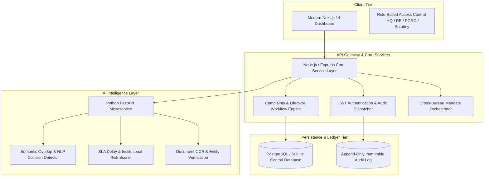

# AICTE Sanyojika - System Architecture & Functional Specification

**Problem Statement:** SIH 2026 PS-262 / PS-264: Intelligent Institution Complaint Monitoring & Coordination System  
**Target Organization:** All India Council for Technical Education (AICTE), Ministry of Education, Govt. of India  
**System Name:** **Sanyojika (संयोजिका)** — *The Intelligent Inter-Agency Governance & Grievance Coordination Engine*

---

## 1. Executive Summary

In the existing administrative ecosystem of technical education in India, hundreds of complaints and inspection reports are filed across disparate bodies:
- **PGRC** (Public Grievance Redressal Cell)
- **RB** (Regional Bureaus - North, South, East, West, Central)
- **Approval Bureau** (Institutions Regulation & Accreditation)
- **Vigilance & Legal Cells**

Without centralized inter-bureau intelligence, institutional bad actors exploit regulatory silos. Sanyojika eliminates duplicated inspections, detects overlapping grievances across independent portals, and orchestrates cross-bureau actions through an automated, AI-assisted platform.

---

## 2. High-Level Architectural Topology

---

## 3. Core Functional Pillars

### 3.1 Multi-Bureau Role Switching & Governance
- **HQ Admin:** High-level executive oversight, pan-India institutional intelligence, inter-bureau dispute resolution.
- **Bureau Head (RB):** Regional oversight, physical inspection dispatch, territorial compliance enforcement.
- **Bureau Head (PGRC):** Student/Faculty grievance intake, whistleblower protection, capitation fee monitoring.
- **Scrutiny Officer:** First-line document verification, evidentiary analysis, preliminary case admission.

### 3.2 Real-Time Overlap Detection Engine
The overlap engine computes a multi-factor collision index ($S_{overlap}$):
$$S_{overlap} = w_1 \cdot S_{semantic} + w_2 \cdot S_{institution} + w_3 \cdot S_{category} + w_4 \cdot S_{temporal}$$
Where:
- $S_{semantic}$: Cosine similarity of complaint narrative embeddings ($0 \le S \le 1$).
- $S_{institution}$: Exact or alias match on Permanent AICTE Institution ID (PID).
- $S_{category}$: Category ontology overlap (e.g., Capitation Fees vs Faculty Non-Payment).
- $S_{temporal}$: Proximity decay function ($e^{-\lambda \Delta t}$).

### 3.3 Force-Directed Relationship Topology Graph
Cases and institutions form an interactive topological network graph:
- **Institution Nodes (Hubs):** Coloured by risk classification.
- **Complaint Nodes (Spokes):** Coloured by investigating bureau.
- **Overlap Edges (Bridges):** Highlight concurrent investigations to prevent contradictory rulings.

---

## 4. Security & Compliance
- **Zero-Knowledge Whistleblower Privacy:** Redaction of student identifiers during cross-bureau review.
- **Immutable Ledger:** Cryptographic hash chaining on audit logs for zero-tamper accountability.
- **DPDP Act 2023 Conformance:** Sovereign data residency and role-scoped data visibility.
